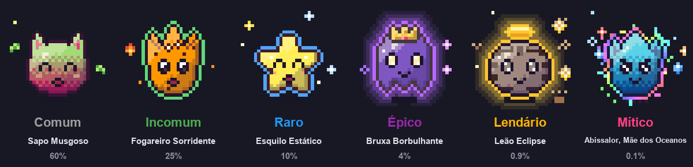
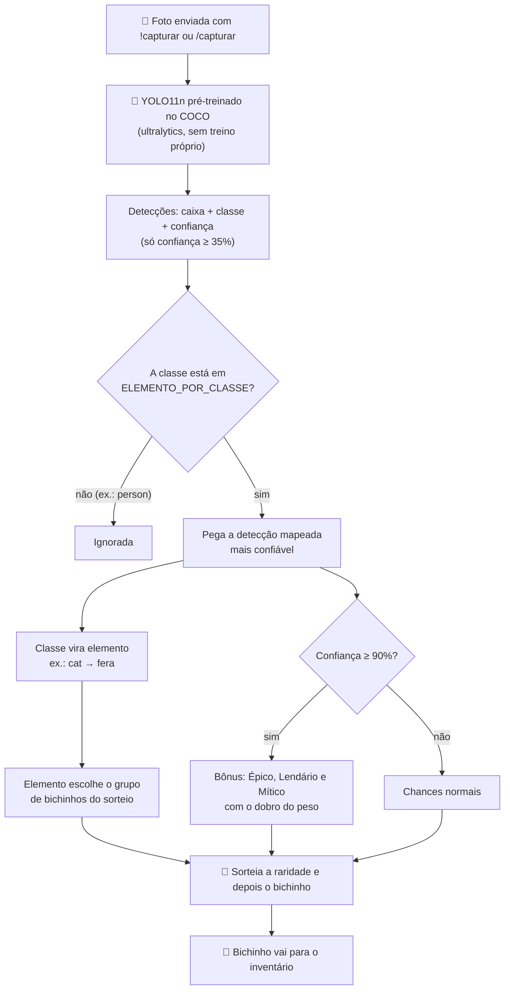
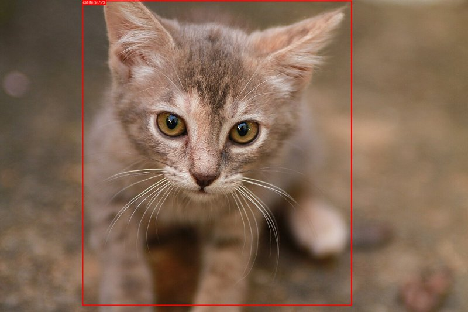
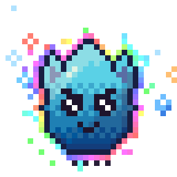
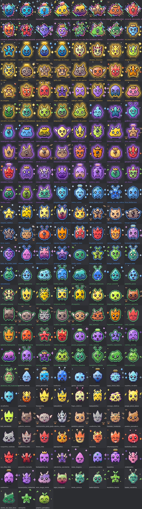

# 🐾 SpriteRNG

> **Bot de Discord que transforma fotos de objetos reais em bichinhos elementais colecionáveis.** Uma rede neural de visão computacional (YOLO11n) olha a sua foto, descobre o objeto e define o elemento do bichinho; depois a sorte (RNG) decide qual dos **195 bichinhos** vem para a sua coleção.

Projeto do curso **Kodland Python Pro**, feito em Python com `discord.py`, `ultralytics` (YOLO), SQLite e Pillow.



## 📑 Sumário

1. [O que é o SpriteRNG](#-o-que-é-o-spriterng)
2. [Como funciona a visão computacional](#-como-funciona-a-visão-computacional)
3. [Raridades e chances](#-raridades-e-chances)
4. [Elementos](#-elementos)
5. [Comandos](#-comandos)
6. [Autoroll](#-autoroll)
7. [HUD efêmero com abas](#-hud-efêmero-com-abas)
8. [Títulos](#-títulos)
9. [Trocas](#-trocas)
10. [Chatbot](#-chatbot)
11. [Capturas do bot no Discord](#-capturas-do-bot-no-discord)
12. [Estrutura de arquivos](#-estrutura-de-arquivos)
13. [Instalação no Windows](#-instalação-no-windows)
14. [Configuração no Discord Developer Portal](#-configuração-no-discord-developer-portal)
15. [Onde ajustar as constantes](#-onde-ajustar-as-constantes)
16. [Tecnologias](#-tecnologias)
17. [Licença e créditos](#-licença-e-créditos)

---

## 🎮 O que é o SpriteRNG

O SpriteRNG é um bot de Discord de **colecionar bichinhos por sorte**. Existem **195 bichinhos** originais, todos com sprites em pixel art gerados por código (o gerador usa só Pillow e é determinístico: o mesmo bichinho sempre gera a mesma imagem). Cada bichinho tem um **elemento** e uma **raridade**.

O que o bot faz:

- 📸 **Captura por foto:** você manda a foto de um objeto (um gato, uma planta, uma xícara, um celular...) e o bot, usando visão computacional, descobre qual é o objeto. O objeto define o elemento e a sorte define o bichinho.
- 🎲 **Rolls:** sorteio de bichinhos de qualquer elemento com `!roll`, ou um roll extra com moedas (`!comprar`).
- 🤖 **Autoroll:** o bot rola sozinho por você enquanto você estiver ativo no servidor.
- 📜 **Missão diária:** capture o elemento do dia e ganhe um roll grátis.
- 🗂️ **Coleção:** inventário, ficha de cada bichinho com imagem, index de descobertos (nunca é apagado), ranking e moedas.
- 🪙 **Economia e trocas:** venda bichinhos por moedas, dê presentes e faça trocas seguras com botões.
- 🏅 **Títulos:** 41 títulos desbloqueáveis (alguns secretos) que podem virar cargo colorido e apelido no servidor.
- 🎛️ **HUD pessoal:** um painel só seu (efêmero) com estatísticas e controles.
- 💬 **Chatbot:** o bot conversa quando chamam pelo nome, por @ ou por reply.

Todos os comandos funcionam **com `!` (prefixo) e com `/` (comandos de barra)**.

---

## 👁️ Como funciona a visão computacional

O bot **não treina nenhum modelo**. Ele usa o **YOLO11n** (a versão "nano", pequena e rápida) já **pré-treinado no dataset COCO**, carregado pela biblioteca `ultralytics`. O COCO ensina o modelo a reconhecer 80 tipos de objetos do dia a dia. O arquivo do modelo (`dados/yolo11n.pt`) é baixado automaticamente pela `ultralytics` na primeira vez que o bot precisa dele.

### Passo a passo

1. **Recebimento da foto:** você usa `!capturar` com uma imagem anexada (ou `/capturar` com o campo `foto`). O bot salva a foto numa pasta temporária.
2. **Detecção:** a foto vai para o YOLO (`visao.detectar`). Ele devolve vários objetos encontrados; para cada um há uma **caixa** (a posição na foto), o **nome da classe** do COCO (por exemplo `cat`) e uma **confiança** de 0 a 1. Só são aceitas detecções com pelo menos **35%** de confiança (`CONFIANCA_MINIMA`).
3. **Filtro:** classes que não estão na tabela de elementos (como `person`, pessoas) são **ignoradas**. Sobram só os objetos "mapeados".
4. **Melhor detecção:** das que sobraram, o bot escolhe a **mais confiável**.
5. **Elemento:** a classe vira um elemento pela tabela `ELEMENTO_POR_CLASSE` (veja abaixo). Exemplo: `cat` vira `fera`.
6. **Sorteio:** o elemento decide **o grupo de bichinhos** que pode ser sorteado (só bichinhos de Fera, no exemplo).
7. **Bônus de raridade:** se a confiança for **maior ou igual a 90%** (`CONFIANCA_PARA_BONUS`), as raridades Épico, Lendário e Mítico ficam **duas vezes mais prováveis** (veja a [tabela de chances](#-raridades-e-chances)). Foto nítida e objeto bem enquadrado compensam!
8. **Resposta:** o bot mostra o bichinho, a foto com a caixa desenhada, o objeto detectado e a confiança.

Se nenhum objeto mapeado for encontrado, o bot avisa que não detectou nada e **não gasta** a sua espera.

### Diagrama



### Exemplo real

Foto de um gatinho enviada ao detector. O YOLO achou um `cat` com 79% de confiança, que vira o elemento **Fera 🐾**. Como 79% é menor que 90%, o sorteio seria sem bônus.



*Foto: "Kitten 5.jpg", de Lisafern, no Wikimedia Commons, em domínio público (CC0 1.0). Fonte: <https://commons.wikimedia.org/wiki/File:Kitten_5.jpg>. A imagem acima foi reduzida e recebeu a caixa desenhada por `visao.desenhar_deteccoes`.*

### Tabela objeto → elemento

Esta é a tabela `ELEMENTO_POR_CLASSE` de `visao.py` (nomes das classes do COCO, em inglês):

| Elemento | Objetos (classe do COCO) |
|---|---|
| 🌿 Natureza | `potted plant`, `broccoli`, `carrot`, `apple`, `orange`, `banana` |
| 🔥 Fogo | `pizza`, `hot dog`, `donut`, `cake`, `sandwich`, `oven`, `microwave`, `toaster` |
| 💧 Água | `cup`, `bottle`, `wine glass`, `bowl`, `sink`, `umbrella` |
| ⚡ Elétrico | `cell phone`, `laptop`, `tv`, `remote`, `keyboard`, `mouse`, `hair drier`, `clock` |
| 🔮 Místico | `book`, `vase`, `teddy bear`, `scissors`, `kite` |
| 🐾 Fera | `cat`, `dog`, `bird`, `horse`, `sheep`, `cow`, `elephant`, `bear`, `zebra`, `giraffe` |

Qualquer outra classe (incluindo `person`) é ignorada.

> 💡 O YOLO roda numa thread separada (`asyncio.to_thread`), para o bot não travar enquanto analisa a foto.

---

## 🎲 Raridades e chances

São 6 raridades. A raridade é sorteada primeiro (com as chances abaixo como pesos) e depois o bot escolhe, ao acaso, um bichinho daquela raridade (e do elemento detectado, no caso da captura).

| Raridade | Bichinhos | Chance normal | Chance com bônus (foto ≥ 90%) | Pontos no ranking | Venda (moedas) |
|---|---:|---:|---:|---:|---:|
| ⚪ Comum | 50 | 60% | 57,14% | 1 | 5 |
| 🟢 Incomum | 40 | 25% | 23,81% | 3 | 15 |
| 🔵 Raro | 30 | 10% | 9,52% | 10 | 50 |
| 🟣 Épico | 30 | 4% | 7,62% | 30 | 150 |
| 🟡 Lendário | 30 | 0,9% | 1,71% | 100 | 500 |
| 🌈 Mítico | 15 | 0,1% | 0,19% | 500 | 2.500 |

Como o bônus funciona: os pesos de Épico, Lendário e Mítico são **multiplicados por 2** (8, 1,8 e 0,2) e tudo é **reescalado para somar 100%** de novo (soma 105 antes de reescalar). Só o `!capturar` (e a captura da missão) usa o bônus; `!roll`, `!comprar`, autoroll e o roll grátis da missão usam as chances normais.


Os míticos são **GIFs animados** (flutuando, com partículas e brilho arco-íris):



Galeria com todos os 195 bichinhos (gerada por `python sprites.py`):



---

## 🌍 Elementos

Cada elemento tem um grupo de bichinhos próprio (32 ou 33 de cada, somando 195):

| Elemento | Bichinhos |
|---|---:|
| 🌿 Natureza | 32 |
| 🔥 Fogo | 32 |
| 💧 Água | 33 |
| ⚡ Elétrico | 32 |
| 🔮 Místico | 33 |
| 🐾 Fera | 33 |

O elemento vem do objeto fotografado (veja a [tabela](#tabela-objeto--elemento)). No `!roll`, o elemento é aleatório. Cada bichinho tem nome, descrição curta e uma aparência única.

---

## ⌨️ Comandos

Todos os comandos funcionam com **`!`** e com **`/`**. Parâmetros entre `< >` são obrigatórios e entre `[ ]` são opcionais.

### Sorteio e economia

| Comando | O que faz |
|---|---|
| `!capturar` + foto / `/capturar foto:` | Captura um bichinho do elemento do objeto da foto. Espera de 5 s entre capturas. Confiança alta dá bônus. |
| `!roll` / `/roll` | Sorteia um bichinho de qualquer elemento, sem bônus. Espera de 5 s. Fica bloqueado com o autoroll ligado. |
| `!comprar` / `/comprar` | Compra um roll extra por 100 moedas, sem espera. |
| `!autoroll` / `/autoroll` | Liga e desliga o roll automático (veja [Autoroll](#-autoroll)). |
| `!missao` / `/missao` | Mostra a missão diária: capture o elemento do dia e ganhe um roll grátis. |
| `!moedas` / `/moedas` | Mostra o seu saldo (todo jogador começa com 100 moedas). |
| `!vender <bichinho>` | Vende um bichinho por moedas (valores na tabela de raridades). |
| `!dar @usuario <bichinho>` | Dá um bichinho de presente. |
| `!trade @usuario` | Abre uma troca de bichinhos e moedas com botões (veja [Trocas](#-trocas)). |

### Coleção e perfil

| Comando | O que faz |
|---|---|
| `!inv [@usuario]` | Mostra o inventário (seu ou de outra pessoa), paginado. |
| `!ver <bichinho>` | Ficha do bichinho com a imagem. Aceita nome parcial e erro de digitação. |
| `!index [elemento]` | Quantos bichinhos você já descobriu, opcionalmente de um elemento (`natureza`, `fogo`, `agua`, `eletrico`, `mistico` ou `fera`). |
| `!rank` | Ranking dos maiores colecionadores (por pontos de raridade). |
| `!status [@usuario ou nome]` | Status públicos de um jogador (rolls, raridades, melhor bichinho, descobertos, pontos, autoroll, título). Aceita menção, id ou parte do nome/apelido. |
| `!hud` / `/hud` | Abre o seu painel pessoal (veja [HUD](#-hud-efêmero-com-abas)). |
| `!titulos` | Lista todos os títulos e como desbloquear cada um. |
| `!titulo [nome]` | Equipa um título desbloqueado (aceita nome parcial). `!titulo remover` (ou sem nome) tira o título. |
| `!ajuda` / `/ajuda` | Explica como jogar e lista os comandos. |

---

## 🤖 Autoroll

O `!autoroll` (ou `/autoroll`) **liga e desliga** o roll automático:

- Ligado, o bot faz **um roll a cada 25 segundos** por você (mesmas chances do `!roll`) e guarda o resultado no inventário.
- Enquanto está ligado, o `!roll` fica bloqueado. O `!capturar` continua funcionando.
- No canal onde foi ligado, o bot **só avisa** (mencionando você) quando a raridade for **igual ou maior** que a escolhida em "Avisar a partir de" (padrão: Raro). O resto é silencioso.
- Dá para configurar **auto-venda**: nada (padrão), vender comuns, ou vender comuns e incomuns na hora. O bichinho vendido ainda conta como descoberto e nas estatísticas.
- Desliga sozinho depois de **10 minutos** sem mensagens suas no servidor, e avisa no canal.
- Fica só na memória: ao reiniciar o bot, todos os autorolls voltam desligados.

---

## 🎛️ HUD efêmero com abas

O `/hud` abre um painel **efêmero** ("só você pode ver"). Como o prefixo `!` não consegue mensagens efêmeras, o `!hud` manda uma mensagem com o botão **"Abrir meu HUD"**, e quem clica recebe o **próprio** HUD. Só o dono mexe nele, e ele expira em 5 minutos.

**Aba 📊 Status:**
- rolls por tipo (normais, autorolls, comprados, capturas) e por raridade;
- melhor bichinho, moedas, bichinhos no inventário e descobertos (de 195);
- autoroll (ligado ou não, e o tempo até o próximo) e esperas do `!roll` e do `!capturar`;
- controles: botão do autoroll, menu "Avisar a partir de", menu de auto-venda, menu de título rápido, botão "Título no apelido" e botão "Atualizar".

**Aba 🏅 Títulos:** todos os títulos, 5 por página, com botão para **Equipar** / Equipado ✓ / 🔒 (bloqueado), botão para remover o título, o botão de título no apelido e setas ◀ ▶ para navegar.

---

## 🏅 Títulos

Há **41 títulos** no total: **30 normais** (listados abaixo) e **11 secretos**. Os secretos aparecem como "❓ ???" até alguém conseguir, então descubra jogando! 🤫

Ao desbloquear um título, o bot anuncia no canal. Com `!titulo <nome>` (ou pelo HUD) você **equipa** o título: o bot cria um cargo colorido "emoji Nome" e, se você deixar, o título aparece no seu apelido (por exemplo `Nome 「Título」`). Ao remover, o apelido original volta.

| Título | Como desbloquear |
|---|---|
| 🐣 Filhote Curioso | Fazer 10 rolls |
| 📸 Clique Certeiro | Capturar 1 bichinho por foto |
| 🤝 Aperto de Pata | Concluir 1 troca com alguém |
| 🔷 Olho de Safira | Conseguir um bichinho Raro |
| 🎲 Dado Inquieto | Fazer 100 rolls |
| 📒 Colecionador Aprendiz | Descobrir 25 bichinhos |
| 🤖 Piloto Automático | Fazer 100 autorolls |
| 💜 Aura Violeta | Conseguir um bichinho Épico |
| 🎁 Coração Generoso | Dar 5 presentes com `!dar` |
| 🐷 Cofrinho Cheio | Ter 1.000 moedas de uma vez |
| 🔍 Lente Afiada | Capturar 25 bichinhos por foto |
| 📖 Guardião do Álbum | Descobrir 50 bichinhos |
| 🧭 Explorador Diário | Completar 7 missões diárias |
| 🌊 Maré de Sorte | Fazer 500 rolls |
| 👑 Coroa Dourada | Conseguir um bichinho Lendário |
| 🧳 Mercador Viajante | Concluir 10 trocas |
| 🎡 Roda da Fortuna | Fazer 1.000 rolls |
| ⚙️ Engrenagem Incansável | Fazer 1.000 autorolls |
| 📷 Fotógrafo Elemental | Capturar 100 bichinhos por foto |
| 📚 Enciclopédia Viva | Descobrir 100 bichinhos |
| 🌈 Toque do Arco-Íris | Conseguir um bichinho Mítico |
| 💰 Tesouro do Dragão | Ter 10.000 moedas de uma vez |
| 🦉 Sábio dos Espíritos | Descobrir 150 bichinhos |
| 🌀 Lenda do Giro | Fazer 5.000 rolls |
| 🌿 Coração da Floresta | Descobrir todos os bichinhos de Natureza |
| 🔥 Chama Eterna | Descobrir todos os bichinhos de Fogo |
| 💧 Alma das Marés | Descobrir todos os bichinhos de Água |
| ⚡ Faísca Viva | Descobrir todos os bichinhos Elétricos |
| 🔮 Oráculo Arcano | Descobrir todos os bichinhos Místicos |
| 🐾 Rei da Matilha | Descobrir todos os bichinhos Fera |

> Para o bot mexer em cargos e apelidos, ele precisa das permissões certas (veja a [configuração no Discord](#-configuração-no-discord-developer-portal)). Sem elas, ele só avisa, sem dar erro. O Discord também não deixa nenhum bot mudar o apelido do dono do servidor.

---

## 🤝 Trocas

`!trade @usuario` abre uma mensagem de troca entre duas pessoas, controlada por botões:

- 📦 **Escolher bichinho** (menu com o seu inventário) ou ⌨️ **Digitar bichinho** (nome e quantidade);
- 🪙 **Moedas:** quanto você oferece;
- ✅ **Confirmar** e ✖️ **Cancelar**.

Regras de segurança: **qualquer mudança na oferta desfaz a confirmação dos dois**, e a troca só acontece quando ambos confirmaram. A troca é feita numa **única transação** no banco (tudo ou nada): se alguém não tiver mais o que ofereceu, nada muda. A mensagem expira em 3 minutos. Para dar algo sem receber nada em troca, use `!dar`.

---

## 💬 Chatbot

Além dos comandos, o SpriteRNG **conversa**. Ele responde quando:

- a mensagem contém, como palavra, **`sprite`**, **`sprites`**, **`spriterng`** ou **`rng`**, sem diferenciar maiúsculas nem acentos e inclusive **esticados** (`spriteeeee`, `rrrnggg`, `spriterrrnnnggg`);
- alguém **marca o bot** com @;
- alguém **responde (reply)** a uma mensagem dele.

As respostas dependem de palavras-chave na mensagem (por exemplo sobre captura, autoroll, HUD, títulos, trocas, chances, missão, elementos, agradecimentos, "oi" e "tchau"), com uma resposta padrão quando ele não entende. Mensagens que começam com `!` são comandos e não passam pelo chatbot.

---

## 📷 Capturas do bot no Discord

<!--
  PARA O AUTOR: adicione prints reais do bot rodando em um servidor, salve-os em docs/ e descomente as linhas abaixo.
  Sugestões de capturas:
    - docs/print_capturar.png : o resultado de um !capturar (foto com a caixa, bichinho sorteado e embed)
    - docs/print_hud.png      : o HUD efêmero aberto (aba Status ou Títulos)
    - docs/print_trade.png    : uma troca em andamento com os botões

  
  
  
-->

Enquanto não há prints do Discord, veja as imagens das seções [Como funciona a visão computacional](#-como-funciona-a-visão-computacional) e [Raridades e chances](#-raridades-e-chances).

---

## 🗂️ Estrutura de arquivos

```text
.
├── main.py          # bot, eventos e comandos
├── catalogo.py      # catálogo de bichinhos, elementos e raridades
├── sorteio.py       # chances, bônus, entrega e missão diária
├── visao.py         # YOLO: detecção e tabela objeto -> elemento
├── banco.py         # SQLite: moedas, inventário, estatísticas...
├── autoroll.py      # roll automático
├── hud.py           # painel efêmero com abas
├── titulos.py       # lista e regras dos títulos
├── cargos.py        # cargos e apelidos dos títulos
├── membros.py       # busca de membros por nome
├── trade.py         # trocas com botões
├── chatbot.py       # respostas por palavras-chave
├── embeds.py        # montagem das mensagens (embeds)
├── sprites.py       # gerador dos sprites em pixel art
├── dados/
│   └── bichinhos.json   # os 195 bichinhos
├── docs/            # imagens do README
├── SPEC.md          # especificação (contrato entre módulos)
├── requirements.txt
├── .env.example
└── LICENSE
```

- **`main.py`**: cria o bot (prefixo `!`, intents), trata eventos (`on_message`, erros) e define todos os comandos híbridos (`!` e `/`). A lógica pesada fica nos outros módulos.
- **`catalogo.py`**: carrega `dados/bichinhos.json` uma vez, define os elementos e as raridades (com chances e cores) e oferece `por_id`, `filtrar` e `buscar` (sem acento, com nome parcial e tolerância a erros de digitação via `difflib`).
- **`sorteio.py`**: calcula as chances (normais e com bônus), sorteia a raridade e o bichinho, entrega o bichinho ao jogador (inventário e estatísticas) e cuida da missão diária (o elemento do dia é o mesmo para todos).
- **`visao.py`**: carrega o YOLO11n sob demanda, detecta objetos, filtra pela tabela `ELEMENTO_POR_CLASSE`, devolve a melhor detecção e desenha as caixas na foto.
- **`banco.py`**: toda a persistência em SQLite (`dados/jogo.db`): usuários e moedas, inventário, descobertos, esperas, estatísticas, configurações, títulos e contadores, e a troca atômica.
- **`autoroll.py`**: uma tarefa `asyncio` por usuário que rola a cada intervalo, avisa raridades altas, faz auto-venda e desliga por inatividade.
- **`hud.py`**: o HUD efêmero (abas Status e Títulos, menus e botões) e o botão "Abrir meu HUD" do `!hud`.
- **`titulos.py`**: a lista de títulos com suas regras e funções que calculam o progresso, verificam desbloqueios e anunciam novos títulos.
- **`cargos.py`**: cria e organiza os cargos de título, mexe no apelido e transforma falta de permissão em avisos amigáveis.
- **`membros.py`**: conversor que acha um membro por menção, id ou nome/apelido (sem acento nem maiúsculas), pedindo mais detalhes quando há ambiguidade.
- **`trade.py`**: a lógica da troca (`Troca`) e a interface com botões, menus e formulários (`ViewTroca`).
- **`chatbot.py`**: detecta o nome do bot (inclusive esticado) e escolhe uma resposta por intenção.
- **`embeds.py`**: monta todas as mensagens bonitas (capturas, inventário, fichas, ranking, HUD, títulos, troca).
- **`sprites.py`**: gera os sprites (PNG 256x256 em pixel art; GIF animado para míticos) em `sprites/` e a galeria `sprites/_galeria.png`.

> Os sprites, o banco (`dados/jogo.db`) e o modelo (`dados/yolo11n.pt`) são gerados em tempo de execução e não vão para o Git (veja o `.gitignore`).

---

## 🛠️ Instalação no Windows

Requisitos: **Python 3.12** (recomendado) instalado e uma conta no Discord.

1. **Baixe o projeto** e abra um terminal (PowerShell) na pasta dele:

   ```powershell
   git clone https://github.com/Batatonez/Kodland-PythonPro.git
   cd Kodland-PythonPro
   ```

2. **Crie e ative um ambiente virtual:**

   ```powershell
   python -m venv venv312
   venv312\Scripts\Activate.ps1
   ```

   > Se o PowerShell bloquear o script de ativação, rode `Set-ExecutionPolicy -Scope CurrentUser RemoteSigned` e tente de novo. No `cmd`, use `venv312\Scripts\activate.bat`.

3. **Instale as dependências:**

   ```powershell
   pip install -r requirements.txt
   ```

   > A `ultralytics` puxa o PyTorch, então a instalação é grande e pode demorar.

4. **Crie o arquivo `.env`** a partir do exemplo e coloque o token do seu bot:

   ```powershell
   copy .env.example .env
   notepad .env
   ```

   O conteúdo deve ficar assim (troque pelo token real, **nunca** compartilhe nem comite esse arquivo):

   ```text
   DISCORD_TOKEN=cole_seu_token_aqui
   ```

5. **Configure o bot no Discord** (próxima seção) e convide-o para o seu servidor.

6. **Rode o bot:**

   ```powershell
   python main.py
   ```

   Na primeira captura, a `ultralytics` baixa o `yolo11n.pt` para a pasta `dados/` e o bot gera os sprites de que precisar. Para gerar todos os sprites de uma vez (e a galeria), rode `python sprites.py`. Ao iniciar, o bot sincroniza os comandos de barra (`/`).

---

## 🔧 Configuração no Discord Developer Portal

1. Acesse o [Discord Developer Portal](https://discord.com/developers/applications), clique em **New Application** e dê um nome (por exemplo, SpriteRNG).
2. No menu **Bot**, clique em **Reset Token** para obter o token e coloque-o no `.env`.
3. Ainda em **Bot**, em **Privileged Gateway Intents**, ligue:
   - ✅ **Message Content Intent** (necessário para ler os comandos com `!` e o chatbot);
   - ✅ **Server Members Intent** (necessário para achar jogadores pelo nome no `!status` e saber se um cargo de título ficou vazio). Se ele estiver desligado, o bot reinicia sozinho sem esse intent e só encontra quem já falou com ele.
4. Em **OAuth2 > URL Generator**, marque os escopos **`bot`** e **`applications.commands`**.
5. Nas permissões do bot, marque pelo menos:
   - **Gerenciar Cargos** (Manage Roles), para criar e dar os cargos coloridos dos títulos;
   - **Gerenciar Apelidos** (Manage Nicknames), para pôr o título no apelido;
   - as permissões básicas de um bot de mensagens: ver canais, enviar mensagens, incorporar links (embeds), anexar arquivos, ler o histórico e usar comandos de barra.
6. Abra a URL gerada, escolha o servidor e autorize o bot.
7. No servidor, em **Configurações do servidor > Cargos**, **arraste o cargo do bot para o alto da lista**. O Discord só deixa o bot mexer em cargos e apelidos de quem tem cargo **abaixo** do dele.

---

## ⚙️ Onde ajustar as constantes

| O que ajustar | Onde | Constante |
|---|---|---|
| Confiança mínima do YOLO | `visao.py` | `CONFIANCA_MINIMA` (0,35) |
| Objetos e seus elementos | `visao.py` | `ELEMENTO_POR_CLASSE` |
| Confiança que dá bônus | `sorteio.py` | `CONFIANCA_PARA_BONUS` (0,9) |
| Raridades com bônus e multiplicador | `sorteio.py` | `RARIDADES_COM_BONUS`, `MULTIPLICADOR_BONUS` (2) |
| Chances base, nomes e cores das raridades | `catalogo.py` | `RARIDADES` |
| Elementos | `catalogo.py` | `ELEMENTOS` |
| Esperas de `!capturar` e `!roll` | `main.py` | `ESPERA_CAPTURAR`, `ESPERA_ROLL` (5 s) |
| Preço do roll extra | `main.py` | `PRECO_ROLL_EXTRA` (100) |
| Moedas iniciais, pontos de ranking e preço de venda | `banco.py` | `MOEDAS_INICIAIS`, `PONTOS_RARIDADE`, `VALOR_VENDA` |
| Intervalo e inatividade do autoroll | `autoroll.py` | `INTERVALO_AUTOROLL` (25 s), `AUTOROLL_INATIVIDADE` (600 s) |
| Tempo de vida do HUD e itens por página de títulos | `hud.py` | `TEMPO_LIMITE`, `TEMPO_LIMITE_BOTAO`, `TITULOS_POR_PAGINA` |
| Tempo limite da troca | `trade.py` | `TEMPO_LIMITE` (180 s) |
| Títulos e regras | `titulos.py` | `TITULOS` |
| Nome e apelidos do chatbot | `chatbot.py` | `NOME_BOT`, `APELIDOS` |

---

## 🧰 Tecnologias

- 🐍 **Python 3.12**
- 💬 **discord.py**: bot, comandos híbridos, botões, menus e formulários
- 👁️ **ultralytics (YOLO11n)** com PyTorch: detecção de objetos
- 🗄️ **SQLite** (módulo `sqlite3` da biblioteca padrão): persistência
- 🖼️ **Pillow**: geração dos sprites e desenho das caixas de detecção
- 🔑 **python-dotenv**: leitura do token no `.env`

---

## 📜 Licença e créditos

O **código deste repositório** é distribuído sob a **licença MIT**: veja o arquivo [LICENSE](LICENSE). Copyright (c) 2026 Batatonez.

> ⚠️ **Nota sobre dependências:** a licença MIT cobre apenas o código deste repositório. As dependências têm as **próprias licenças**. Em especial, o **YOLO / `ultralytics` é licenciado sob a AGPL-3.0** (há também licença comercial da Ultralytics), então confira as condições dela antes de distribuir ou hospedar uma versão modificada do bot como serviço. `discord.py`, `Pillow` e `python-dotenv` também têm suas licenças próprias.

Créditos:

- **YOLO11 / ultralytics**: [Ultralytics](https://github.com/ultralytics/ultralytics). Modelo pré-treinado no dataset **COCO**.
- **discord.py**: [Rapptz/discord.py](https://github.com/Rapptz/discord.py).
- **Pillow**: [python-pillow/Pillow](https://github.com/python-pillow/Pillow).
- **Foto de exemplo** (`docs/exemplo_yolo.jpg`): "Kitten 5.jpg", por Lisafern, Wikimedia Commons, **CC0 1.0** (domínio público): <https://commons.wikimedia.org/wiki/File:Kitten_5.jpg>.
- Os **bichinhos e sprites** são originais e gerados por código (`sprites.py`).
- Projeto desenvolvido como atividade do curso **Kodland Python Pro**.
